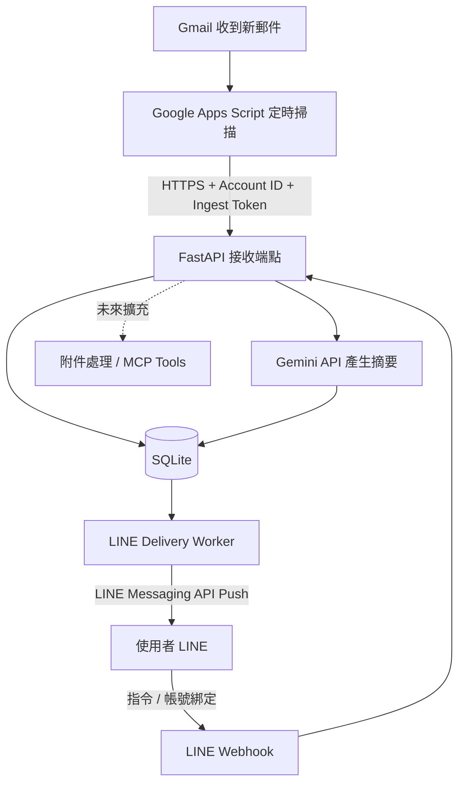

# MailMind 📬

**以 Gmail、Gemini API 與 LINE Messaging API 打造的自動化 AI 電子郵件摘要助手。**

MailMind 會定期偵測新郵件，將內文交由大型語言模型整理成繁體中文摘要，並透過 LINE Bot 推播給使用者。使用者可以直接在 LINE 中切換摘要長度、開關通知，不必反覆開啟信箱查看每封郵件。

專案以 **Side Project、免費額度優先、模組化及可擴充為多人服務** 為設計方向。目前 **v0.3 的 Gmail 收信、LLM 摘要、資料庫去重、LINE 帳號綁定及自動推播已完成實際端到端測試**；PDF、圖片等附件解析與 MCP 工具整合則是後續開發項目。

> **目前版本：v0.3**｜**主要語言：Python、JavaScript (Google Apps Script)**｜**介面：LINE Bot**
>
> 注意：本專案目前適合個人／少量使用者的實驗性部署，尚非經過正式資安稽核的 SaaS 服務。

---

## 目錄

- [核心功能](#核心功能)
- [系統架構](#系統架構)
- [技術堆疊](#技術堆疊)
- [專案結構](#專案結構)
- [安裝與設定](#安裝與設定)
- [Gmail 自動收信設定](#gmail-自動收信設定)
- [LINE Bot 設定與綁定](#line-bot-設定與綁定)
- [啟動自動推播](#啟動自動推播)
- [使用方式](#使用方式)
- [測試與問題排查](#測試與問題排查)
- [多人支援與資料設計](#多人支援與資料設計)
- [免費額度與部署限制](#免費額度與部署限制)
- [隱私與安全](#隱私與安全)
- [開發路線圖與 MCP 規劃](#開發路線圖與-mcp-規劃)

## 核心功能

### 已實作（v0.1–v0.3）

| 功能 | 說明 |
| --- | --- |
| Gmail 自動偵測 | 透過 Google Apps Script 時間觸發器定期掃描新郵件，預設每 5 分鐘一次 |
| AI 郵件摘要 | 使用 Gemini API 將郵件文字整理為繁體中文摘要，盡量保留日期、金額與待辦事項 |
| 三種摘要長度 | `極簡`（short）、`中等`（medium）、`完整`（full）；可直接從 LINE 切換 |
| LINE 主動推播 | 獨立 Worker 定期推送已完成的摘要到使用者 LINE 聊天室 |
| LINE 指令互動 | 支援說明、帳號綁定、摘要模式切換、通知開關及設定查詢 |
| Gmail／LINE 綁定 | 透過限時 15 分鐘、只能使用一次的代碼綁定帳號 |
| 去重與重試 | 以 Gmail Message ID 避免重複摘要；LINE 推播使用資料庫紀錄及 Retry Key 降低重複發送風險 |
| 免費額度保護 | 可設定每位使用者每日摘要數上限、每月 LINE 推播上限，並檢查官方帳號剩餘訊息額度 |
| 多人資料模型 | 使用者、信箱、摘要與推播紀錄分別關聯；目前仍採管理者手動建立帳號 |

### 規劃中（尚未實作）

- PDF、圖片、DOCX 與試算表附件讀取及內容整理。
- 將附件解析、郵件檢索等能力封裝成 **MCP Tools**，供 AI Agent 呼叫。
- 透過 LINE 查詢歷史郵件、附件內容與待辦事項。
- 郵件分類、廣告／電子報過濾、重要程度判斷與每日彙整。
- 更完整的 Gmail OAuth、自助綁定、部署監控和多使用者管理介面。

## 系統架構



整體流程分成兩條：

1. **收信與摘要**：Apps Script 取得 Gmail 新信的寄件者、主旨、純文字內文及 Message ID，送往受 Token 保護的 FastAPI；後端透過 Gemini 產生摘要並存入 SQLite。
2. **LINE 通知與設定**：獨立 Worker 查詢尚未發送的摘要，透過 LINE Push API 傳給對應使用者；LINE Webhook 則處理綁定與設定指令。

兩個排程彼此獨立，預設各約 5 分鐘執行一次。因此新郵件通常**不是秒級推播**，實際延遲取決於排程、API 處理時間與重試狀態。

## 技術堆疊

| 層級 | 使用技術 | 用途 |
| --- | --- | --- |
| 後端 API | Python 3.11、FastAPI、Uvicorn | 收信端點、LINE Webhook、健康檢查 |
| 資料庫／ORM | SQLite、SQLAlchemy | 使用者、信箱、摘要、推播與綁定紀錄 |
| LLM | Google Gemini API、`google-genai` | 繁體中文郵件摘要 |
| Gmail 整合 | Google Apps Script、`GmailApp`、`UrlFetchApp` | 掃描新郵件並送往後端 |
| LINE 整合 | LINE Messaging API、HTTPX | Webhook 回覆、主動推播與額度查詢 |
| 自動化 | Apps Script Trigger、Python Worker | 定時收信及推播 |
| 公開 HTTPS 入口 | Cloudflare Tunnel（目前測試部署） | 讓 Google 與 LINE 能連接本機 API |
| 開發／測試 | `pytest`、`tmux` | 自動測試與背景程序管理 |
| 後續擴充 | MCP／FastMCP、檔案解析套件 | 尚未整合，詳見路線圖 |

本專案目前採用的 Gemini 模型預設為 `gemini-3.5-flash-lite`；可在 `.env` 修改。模型供應狀態、免費額度及 API 規格可能調整，請以 [Gemini API 官方文件](https://ai.google.dev/gemini-api/docs)與帳戶控制台為準。

## 專案結構

以下為 **v0.3 現有結構**（部分測試與文件略）：

```text
MailMind/
├── app/
│   ├── main.py                    # FastAPI 入口
│   ├── config.py                  # 環境變數設定
│   ├── database.py                # SQLAlchemy / SQLite
│   ├── models.py                  # 資料模型
│   ├── routes/
│   │   ├── ingest.py              # Gmail 收信端點
│   │   └── line_webhook.py        # LINE Webhook 與指令處理
│   └── services/
│       ├── summarizer.py          # Gemini 摘要與 Prompt
│       └── line_messaging.py      # LINE Reply / Push API
├── apps_script/
│   └── Code.gs                    # Google Apps Script 收信程式
├── scripts/
│   ├── check_setup.py             # 環境與資料表檢查
│   ├── demo_summary.py            # 虛構郵件摘要測試
│   ├── create_account.py          # 建立信箱帳號及收信 Token
│   ├── create_line_link.py        # 建立 LINE 一次性綁定碼
│   ├── send_test_email.py         # 測試 Gmail Ingest API
│   └── send_pending_line.py       # LINE 待發送摘要 Worker
├── tests/                          # pytest
├── docs/                           # 架構與各版本安裝說明
├── data/                           # SQLite 資料庫（不提交至 Git）
├── requirements.txt
├── .env.example
├── .env.v03.example
├── .gitignore
└── README.md
```

## 安裝與設定

以下假設使用 **Linux / HPC / WSL**，並已將包含 v0.3 程式的 MailMind Repository 放在 `~/MailMind`。若從 GitHub 取得專案，請先複製 Repository 到此目錄。

### 1. Python 環境

```bash
cd ~/MailMind
python3 -m venv .venv
source .venv/bin/activate
python -m pip install --upgrade pip
pip install -r requirements.txt
```

建議 Python 3.11；Windows 使用者需依平台調整虛擬環境啟動方式。

### 2. 建立 `.env`

```bash
cp .env.example .env
nano .env
```

確認 `.env` 包含以下設定（將憑證換成你自己的值）：

```ini
# Gemini
GEMINI_API_KEY=你的_Gemini_API_Key
GEMINI_MODEL=gemini-3.5-flash-lite

# Database：留空時預設 data/mailmind.db
DATABASE_URL=

# 每位使用者每天最多成功摘要的郵件數（UTC 日期）
MAX_DAILY_SUMMARIES=10

# MailMind 專用 LINE Messaging API Channel
MAILMIND_LINE_CHANNEL_SECRET=你的_Channel_Secret
MAILMIND_LINE_CHANNEL_ACCESS_TOKEN=你的_Channel_Access_Token

# 程式端每月 LINE 主動推播保守上限
MAX_LINE_PUSHES_PER_MONTH=150
```

> 請注意：LINE 憑證的**實際變數名稱**是 `MAILMIND_LINE_CHANNEL_SECRET` 與 `MAILMIND_LINE_CHANNEL_ACCESS_TOKEN`，不是其他專案的 `LINE_CHANNEL_SECRET`。不要把 `.env` 提交至 Git。

- Gemini API Key：[Google AI Studio](https://aistudio.google.com/apikey)
- LINE Channel 資訊：[LINE Developers Console](https://developers.line.biz/console/)

### 3. 初始化與測試

```bash
python -m scripts.check_setup
pytest -q
python -m scripts.demo_summary --level medium
```

`check_setup` 會建立所需資料表；`demo_summary` 使用**虛構郵件**測試模型，需要有效的 Gemini API Key。

### 4. 啟動 FastAPI

```bash
uvicorn app.main:app --host 127.0.0.1 --port 8000
```

開啟另一個 Terminal：

```bash
curl http://127.0.0.1:8000/health
```

預期回應：

```json
{"status":"ok","service":"MailMind","version":"0.3.0"}
```

開發時可加上 `--reload`；長時間執行時建議不要使用自動重載模式。

## Gmail 自動收信設定

### 1. 在 MailMind 註冊信箱

```bash
python -m scripts.create_account \
  --email "your-email@gmail.com" \
  --level medium
```

程式會回傳：

```text
ACCOUNT_ID=...
INGEST_TOKEN=...
SUMMARY_LEVEL=medium
```

`INGEST_TOKEN` **只會顯示一次**，後端僅存其 SHA-256 雜湊值。若遺失，可執行下列指令重新產生，但舊 Token 會立刻失效，Apps Script 也必須更新：

```bash
python -m scripts.create_account \
  --email "your-email@gmail.com" \
  --level medium \
  --rotate
```

### 2. 建立 Google Apps Script

1. 使用要監控的 Gmail 帳號進入 [Google Apps Script](https://script.google.com/)，建立專案。
2. 將 Repository 中的 `apps_script/Code.gs` 複製到編輯器。
3. 至 **Project Settings → Script Properties** 新增以下屬性：

| Property | Value |
| --- | --- |
| `BACKEND_URL` | 可公開連接的 **HTTPS API Base URL**，不含結尾 `/` |
| `ACCOUNT_ID` | 上一步產生的 Account ID |
| `INGEST_TOKEN` | 上一步產生的 Token |

例如，如果使用反向代理把 `/mailmind` 轉給 MailMind API，則 `BACKEND_URL` 應設為：

```text
https://<your-domain>/mailmind
```

**不要**再附加 `/api/v1/ingest/gmail`，Apps Script 會自行組合路徑。

> Apps Script 執行在 Google 端，無法直接訪問你電腦上的 `127.0.0.1:8000`。必須提供可連線的 HTTPS 入口。請勿將沒有 Token 驗證的內部端點直接公開。

### 3. 初次測試與排程

在 Apps Script 依序執行：

| 函式 | 用途 |
| --- | --- |
| `mmInitialize()` | 設定首次監控時間，避免一開始掃描所有舊信 |
| `mmSendDemo()` | 傳送虛構郵件，驗證 HTTPS → FastAPI → Gemini → SQLite |
| `mmScanInbox()` | 手動掃描 Gmail 中符合條件的新郵件 |
| `mmInstallTrigger()` | 安裝每 5 分鐘自動掃描的時間觸發器 |
| `mmRemoveTrigger()` | 移除自動掃描觸發器 |

首次使用需要授權 Apps Script 存取 Gmail 及外部 URL。建議先成功執行前三個函式，再安裝定時觸發器。

**目前掃描限制**：

- 僅搜尋 `in:inbox newer_than:2d`、最多前 **80 個對話串**，再逐一處理其中的郵件。
- 僅處理 `mmInitialize()` 設定時間之後收到的訊息；再次呼叫初始化函式不會覆蓋既有時間。
- 每封信最多送出 **12,000 字元**的純文字內文；**不處理附件**。
- 以 Gmail 的 **Message ID** 去重，而不是以 Thread ID 或未讀狀態判斷。
- 處理失敗的信件可能在後續掃描重試；若停機太久或收件量過大，目前的搜尋視窗可能漏信。

## LINE Bot 設定與綁定

### 1. 建立 Messaging API Channel

1. 在 [LINE Official Account Manager](https://manager.line.biz/) 建立專用官方帳號。
2. 在 [LINE Developers Console](https://developers.line.biz/console/) 啟用 Messaging API，取得 Channel Secret 與 Channel Access Token。
3. 將兩項值填入 MailMind 的 `.env`，重新啟動 FastAPI。
4. 在 **Messaging API → Webhook settings** 設定以下 URL，並開啟 **Use webhook**：

```text
https://<your-domain>/mailmind/line/webhook
```

5. 點擊 **Verify**，確認返回成功；可在 Official Account Manager 關閉會干擾的預設自動回覆。

> Verify 成功但 LINE 傳訊息沒有回覆時，先確認 **Use webhook = Enabled**。沒有簽章的手動 POST 收到 HTTP 401 是正常的；LINE 平台以有效簽章呼叫時應得到 HTTP 200。

### 2. Gmail 與 LINE 帳號綁定

先在後端產生一次性代碼：

```bash
python -m scripts.create_line_link --email "your-email@gmail.com"
```

在 **15 分鐘內**，私訊 MailMind 官方帳號：

```text
綁定 <一次性代碼>
```

綁定成功後，Bot 會回覆確認訊息。**綁定之前的歷史郵件會標記為 `skipped`，不會一次全部推播**。

## 啟動自動推播

收信排程與 LINE 推播是**兩個獨立的背景流程**。即使 Gmail 已經成功摘要並存入 SQLite，如果沒有啟動 LINE Worker，也不會主動傳送到 LINE。

### 1. 手動驗證

完成帳號綁定後，從另一個信箱寄入一封全新測試郵件，等待 Apps Script 完成摘要，然後執行：

```bash
python -m scripts.send_pending_line --dry-run
python -m scripts.send_pending_line --once
```

`--dry-run` 只列出待推播的郵件；`--once` 會真正呼叫 LINE Push API。再次執行 `--once` 不應重複推送已成功的郵件。

### 2. 持續執行

```bash
tmux new -s mailmind-line
cd ~/MailMind
source .venv/bin/activate
python -m scripts.send_pending_line --loop --interval 300
```

在 tmux 內按 `Ctrl+B`，放開後按 `D`，即可離開但保持程式執行。

```bash
# 檢查執行中的 Worker
ps aux | grep '[s]end_pending_line'

# 查看背景 Session
tmux ls

# 重新連線
tmux attach -t mailmind-line

# 停止 Worker
tmux kill-session -t mailmind-line
```

**同一個 SQLite 資料庫請只啟動一個 LINE Worker**。重複啟動可能造成競爭與重複推播；tmux 不會在主機重新啟動後自動恢復。

## 使用方式

在 LINE 的 MailMind 聊天室輸入：

| 指令 | 說明 |
| --- | --- |
| `說明` | 顯示支援的指令 |
| `綁定 <代碼>` | 綁定現有 Gmail 帳號 |
| `極簡` | 下一封新郵件使用短摘要，最多約 3 句 |
| `中等` | 下一封新郵件使用約 150～250 字的摘要 |
| `完整` | 下一封新郵件使用較完整的摘要，約 350～600 字 |
| `開啟通知` | 重新開啟後續新郵件推播，不補發先前略過的信件 |
| `關閉通知` | 停止主動推播（**目前不會停止 Gmail 收信及摘要**） |
| `我的設定` | 顯示目前摘要模式與通知開關 |

LINE 訊息會包含寄件者、主旨、摘要模式，以及 Gemini 產生的摘要；長訊息會截斷以符合 LINE 文字訊息長度限制。

> 摘要模式變更只影響**之後新產生的摘要**，不會重新生成資料庫中已存在的摘要。

## 測試與問題排查

### 基本檢查

```bash
python -m scripts.check_setup
pytest -q
curl http://127.0.0.1:8000/health
```

如果有使用路徑型反向代理，可以另外測試：

```bash
curl -i "https://<your-domain>/mailmind/health"
```

### 常見問題

| 現象 | 可能原因及處理方向 |
| --- | --- |
| Gemini 回傳 404 | 模型可能已下架或帳號無權使用；調整 `.env` 的 `GEMINI_MODEL` 並核對可用模型 |
| Gemini 回傳 429 | 免費額度或速率限制；確認用量並等候恢復，不要無限制重試 |
| Apps Script 出現 `duplicate` | 模擬信或相同 Gmail Message ID 已處理；屬於正常去重 |
| 真實郵件沒進資料庫 | 確認 Apps Script 觸發器、初始監控時間、收件匣與查詢視窗，以及 HTTPS 後端是否在線 |
| Webhook Verify 回傳 401 | 確認 `.env` 的 **MailMind Channel Secret** 正確且服務已重啟；不可停用簽章驗證 |
| LINE Verify 成功但指令沒回覆 | 確認 `Use webhook` 已開啟、Channel Token 有效，並檢查 FastAPI 日誌 |
| SQLite 有摘要但 LINE 沒訊息 | 檢查 `send_pending_line` Worker 是否啟動、帳號是否已綁定、通知是否開啟 |
| LINE API 回傳 429 或額度不足 | 確認官方帳號配額和 `MAX_LINE_PUSHES_PER_MONTH`；等待額度恢復 |
| Cloudflare 502／無法連線 | 檢查 FastAPI、反向代理與 Tunnel 程序是否都在執行 |

若需要查看資料庫最近的郵件處理結果：

```bash
python - <<'PY'
import sqlite3

with sqlite3.connect('data/mailmind.db') as db:
    rows = db.execute('''
        SELECT e.subject, e.state,
               CASE WHEN s.id IS NULL THEN 'no summary' ELSE 'summarized' END
        FROM emails e
        LEFT JOIN summaries s ON s.email_id = e.id
        ORDER BY e.created_at DESC
        LIMIT 10
    ''').fetchall()
for subject, state, status in rows:
    print(f'{state:12} | {status:12} | {subject[:60]}')
PY
```

### 現行部署（選用）

目前已驗證可以使用**一條既有 Cloudflare Tunnel**，透過 Flask 反向代理按照 URL 路徑分流不同服務：

```text
Cloudflare HTTPS
    └─ Flask / Waitress :5000
         ├─ /webhook                          → 既有 LINE Bot
         ├─ /mailmind/health                  → FastAPI :8000 /health
         ├─ /mailmind/api/v1/ingest/gmail     → FastAPI :8000 /api/v1/ingest/gmail
         └─ /mailmind/line/webhook            → FastAPI :8000 /line/webhook
```

這是目前環境使用的**可選部署方式**，並不是 MailMind 必須依賴另一個專案。若改用 Caddy、Nginx 或其他反向代理，只要維持 API 路徑、HTTPS 與驗證 Header 正常轉發即可。

MailMind 的 `docs/flask_line_proxy_snippet.py` 提供現有 Flask 入口的 LINE Webhook 轉發範例。代理時要保留 `X-Line-Signature` 與原始請求 Body；Gmail 收信端點則要保留 `X-MailMind-Token`。

## 多人支援與資料設計

目前資料庫已區分不同使用者與信箱，但**還沒有公開註冊、自助 Gmail OAuth 或完整的多租戶營運機制**。

| 資料表 | 用途 |
| --- | --- |
| `users` | LINE User ID、摘要偏好、通知設定 |
| `email_accounts` | Gmail 地址、對應使用者、Ingest Token 雜湊 |
| `emails` | Gmail Message ID、寄件者、主旨、摘要處理狀態 |
| `summaries` | 產生的摘要、模型與摘要長度 |
| `delivery_logs` | LINE 推播狀態、嘗試次數及去重紀錄 |
| `line_link_codes` | 一次性綁定碼雜湊與有效期限 |

目前每個 Gmail 帳號需要獨立的 Apps Script 設定，信箱帳號由管理者 CLI 建立。SQLite 適合目前的單機 Side Project；若發展成多 Worker、多節點或公開多人服務，再考慮 PostgreSQL、工作佇列、OAuth 驗證與完整的權限隔離。

## 免費額度與部署限制

本專案目標是**在既有運算環境及服務免費額度內，盡量維持 NT$0 使用成本**，但**不保證在任何使用量、地區或帳號條件下永遠免費**。

- **Gemini API**：使用可用的免費層級；模型與額度可能調整。預設 `MAX_DAILY_SUMMARIES=10`，以每位使用者、UTC 日期計算成功摘要數。
- **LINE Messaging API**：使用官方帳號可用的免費訊息配額；程式預設 `MAX_LINE_PUSHES_PER_MONTH=150` 作為保守上限，亦會查詢 LINE 官方用量。實際可發送數仍以官方方案為準。
- **Apps Script**：受 Google Apps Script 每日與執行時間配額限制。
- **後端運算環境**：本機／HPC 的運算、電力與網路使用政策仍需自行確認；Cloudflare Quick Tunnel 主要用於開發測試，不是具 SLA 的正式部署方式。
- **持續運行**：Gmail Trigger 在 Google 端排程，但 FastAPI、反向代理、Tunnel 與 LINE Worker 必須同時可用；tmux 只防止 Terminal 中斷，不提供服務自動重啟。

在正式處理大量郵件前，建議優先加入廣告郵件過濾、通知優先級及監控告警，避免免費額度用於不重要的郵件。

## 隱私與安全

- `.env`、API Key、Channel Secret、Access Token、Ingest Token、綁定碼及資料庫檔案**不得提交至 GitHub**。
- Gmail Ingest API 需提供每個信箱自己的 `X-MailMind-Token`，後端資料庫只保存其雜湊。
- LINE Webhook 使用 `X-Line-Signature` 驗證，不接受沒有有效簽章的請求。
- LINE 帳號綁定使用 15 分鐘有效、只能使用一次的代碼；綁定前的歷史郵件不會補發。
- 目前 SQLite 保存寄件者、主旨、摘要等紀錄，**不儲存整封原始郵件內文**；但郵件內容會傳給 Gemini API 處理。
- Apps Script `GmailApp` 需要 Gmail 存取授權。執行前請確認腳本來源可靠，並留意 Google API／模型免費層級的資料使用條款。
- 請勿使用免費模型處理不適合上傳第三方服務的機密、敏感個資、醫療或商業文件。
- 後續 MCP Tools 必須對使用者、可讀取信件及附件範圍進行授權檢查，不可讓郵件內文直接控制工具或存取任意伺服器檔案。

## 開發路線圖與 MCP 規劃

| 版本 | 內容 | 狀態 |
| --- | --- | --- |
| v0.1 | FastAPI、SQLite、Gemini 摘要、基本測試 | ✅ 完成 |
| v0.2 | Gmail Apps Script、自動收信、Token 驗證、去重 | ✅ 完成 |
| v0.3 | LINE Webhook、使用者綁定、摘要模式、自動推播 | ✅ 完成並實測 |
| v0.4 | PDF／圖片／DOCX 附件解析、資料規整 | 📋 規劃中 |
| v0.5 | MCP Tools、LINE 郵件問答、歷史郵件檢索 | 📋 規劃中 |
| v1.0 | 更完整的部署、監控、權限管理與多人操作流程 | 📋 規劃中 |

### 為什麼 MCP 先放在同一個 Repository？

MCP（Model Context Protocol）是讓模型／Agent 以標準介面使用工具的協定，不是 PDF 解析工具本身。因此會先把文件處理寫成可獨立測試的 Python Service，再在需要時包裝成 MCP Tools。

**推薦採用 Monorepo、模組分離**，避免目前就維護第二套部署與驗證流程。以下是**未來規劃的目錄，v0.3 尚不存在**：

```text
app/
├── services/
│   └── attachments/
│       ├── pdf.py
│       ├── image.py
│       ├── docx.py
│       └── spreadsheet.py
└── mcp/
    ├── server.py
    └── tools.py
```

預計提供的工具可能包含 `extract_pdf_text`、`read_image`、`read_docx`、`read_spreadsheet`、`list_attachments` 及 `search_email_history`。先完成解析器與權限檢查，再逐步增加 MCP Server；未來若多個專案都要共用這些工具，再拆成獨立 Repository 或服務。

---

**MailMind 的開發目標：以低成本整合真實 API、非同步流程與 AI 工具，讓電子郵件從「需要逐封閱讀的資訊」變成「能直接採取行動的摘要」。**
